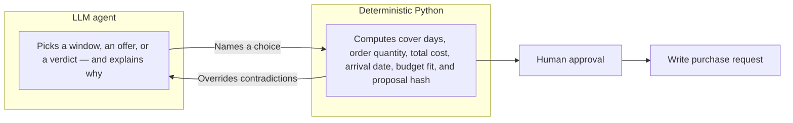
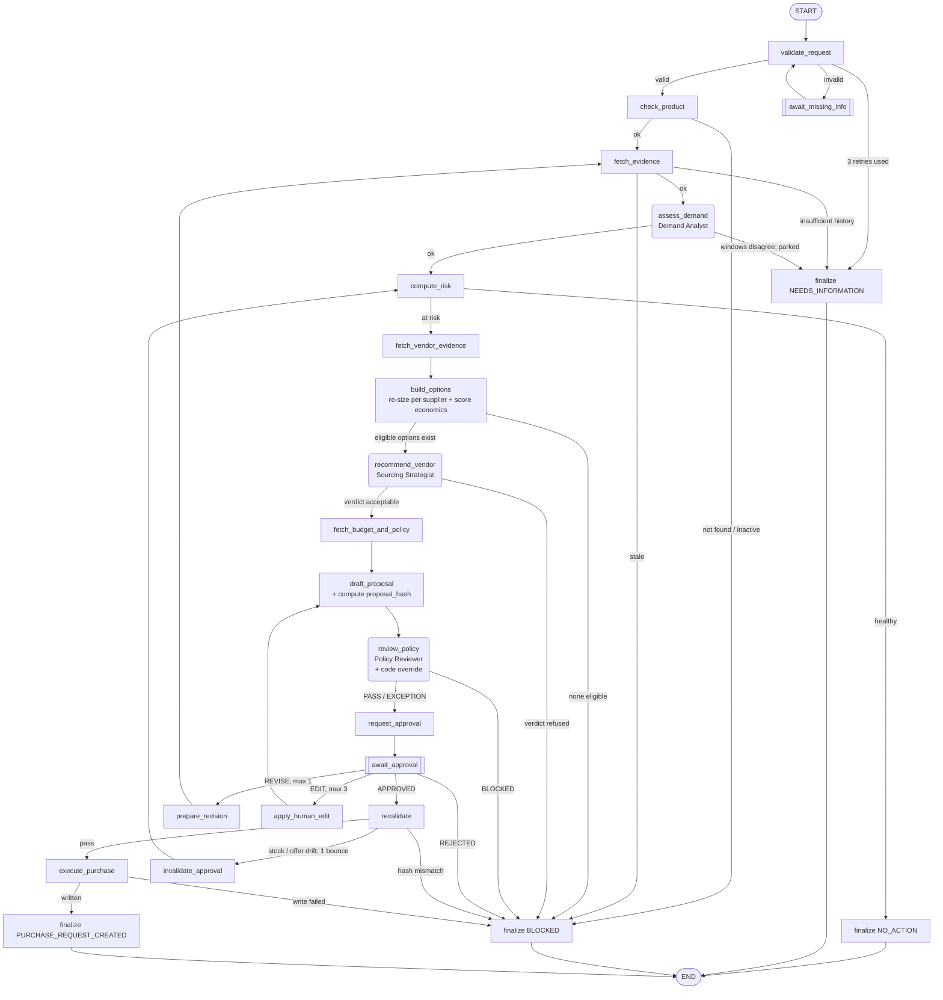
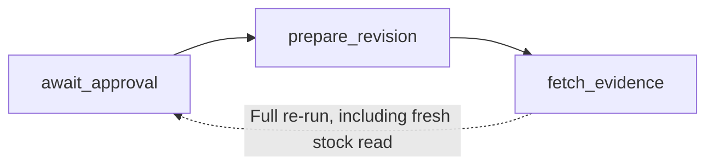
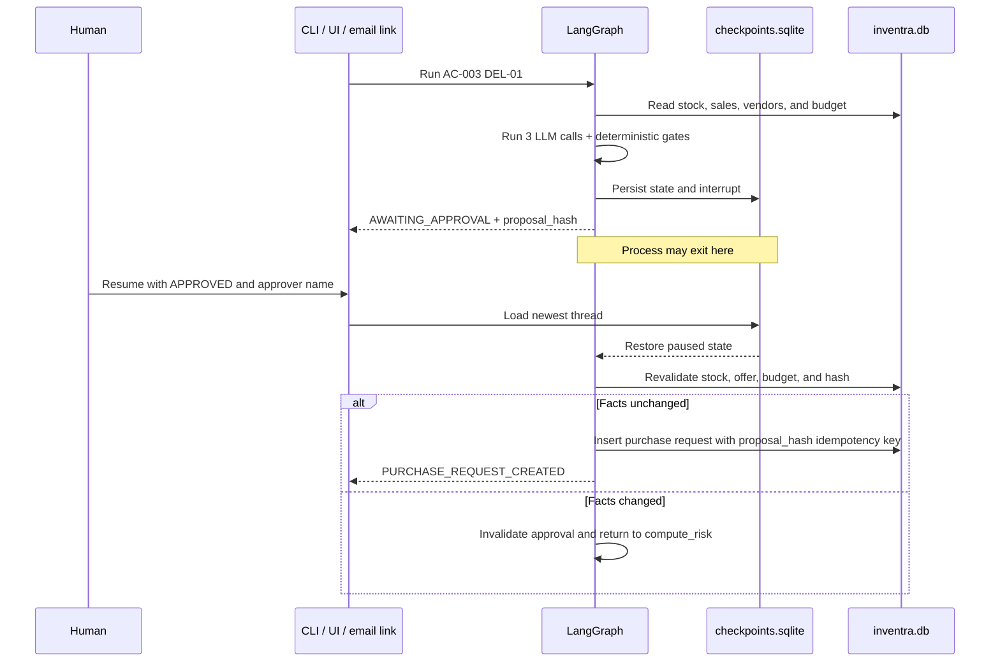

# 📦 Inventra — Agentic Stockout Resolution System

> **Preventing avoidable warehouse stockouts through evidence-based, human-approved replenishment.**

Inventra is an agentic stockout-resolution system. Given one SKU at one warehouse, it gathers operational evidence, determines whether action is needed, sizes and prices a replenishment order, checks the proposal against policy, pauses for a named human to approve it, revalidates the facts, and only then creates a purchase request.

**Built with:** LangGraph · SQLite · Pydantic · Python  
**Architecture:** Three LLM agents; all other decisions and operations are deterministic Python.

<p align="left">
  
  
  
  
  
  
  
</p>

| Project status | Details |
|---|---|
| **Verified on** | Python 3.13.7, Windows; verified 2026-09-11 and live-tested again 2026-09-13 |
| **Tests** | 192 test functions across 32 modules. Last recorded full automated run: **136 passed** across 23 files (2026-09-11). Modules added later do not have a recorded full-suite run. The 2026-09-13 pass was live/manual. |
| **Live models** | Vertex AI `gemini-2.5-flash-lite` / `gemini-2.5-flash` |
| **LLM providers** | Vertex AI, Gemini API, OpenAI |
| **Default demo case** | `AC-003 DEL-01` |

---

## 📚 Table of Contents

- [1. Core Idea](#1-core-idea)
- [2. Quickstart](#2-quickstart)
- [3. Case Flow](#3-case-flow)
- [4. The Three Agents](#4-the-three-agents)
- [5. Seeded Data](#5-seeded-data)
- [6. CLI Reference](#6-cli-reference)
- [7. Human Approval Pauses](#7-human-approval-pauses)
- [8. Safety Guarantees](#8-safety-guarantees)
- [9. Gotchas](#9-gotchas)
- [10. Demo Script](#10-demo-script)
- [11. Streamlit UI and Autonomous Monitor](#11-streamlit-ui-and-autonomous-monitor)
- [12. Email Approval](#12-email-approval)
- [13. Tests](#13-tests)
- [14. Configuration](#14-configuration)
- [15. Troubleshooting](#15-troubleshooting)
- [16. Known Limits](#16-known-limits)
- [17. Project Structure](#17-project-structure)

---

## 1. Core Idea

### The model narrates; code decides

Every agent judgment is bounded by a plain Python function that independently computes the authoritative answer and either enforces or overrides the agent's output.



**Why this matters:** During development, a live run had the Sourcing Strategist narrate an extra cost of **$450** for an option whose computed extra cost was **$1,450**. The model dropped a digit and then described the incorrect figure as a justified investment.

The fix was not a better prompt. The system was changed so that this class of error cannot authorize an action:

- An agent may only cite a figure already present in its evidence bundle.
- An agent is never the authority on whether its own choice is acceptable.
- Deterministic Python recomputes and validates the figures that control the decision.

| Agent judgment | Deterministic code that can override it |
|---|---|
| Which sales window to trust | `calculate_stock_risk` computes cover days from the window the agent names. The agent picks a **window**, never a **number**. |
| Which vendor offer to pick | `economics.evaluate_options` ranks offers by all-in cost per day of cover, not total cost alone. `nodes._validate_recommendation` refuses picks without the `best_value_option` or `within_value_tolerance` verdict. |
| Whether policy passes | `nodes._override_policy_checklist` force-overwrites **7 of 8** checklist rows with deterministically provable answers. |

Only one policy question is left to the agent: **“Which trade-off is being made?”** This is narrative judgment, not a computable fact.

### Agents cannot execute tools

No LLM agent can call a tool. Deterministic graph nodes call tools **before** invoking an agent and pass only the resulting evidence as text.

`call_structured()` accepts a system prompt, a user prompt, and a Pydantic schema. It has no tool list to bind, so `create_purchase_request` is unreachable from agents.

---

## 2. Quickstart

### Prerequisites

- Python 3.13.7 (the version used for verification)
- A terminal such as PowerShell, Command Prompt, or Bash
- An LLM provider only if you want live model calls; the deterministic stub agents work without an API key

### Install and initialize

```bash
# 1. Install dependencies
pip install -r requirements.txt

# 2. Configure environment variables (optional)
cp submission/.env.example submission/.env

# 3. Build and seed the database
python database/seed.py
python -m submission.tests.seed_extra

# 4. Run a case that is reliably at risk
python -m submission.app run AC-003 DEL-01
```

### Expected result

```text
AWAITING_APPROVAL -- case CASE-AC-003-DEL-01
  proposal PROP-5F0F4F397F34 (1740f275a61d...)
  FastShip Inc.: 14 units, $4200.0
  resume with: python -m submission.app resume CASE-AC-003-DEL-01 APPROVED "your name"
```

### Approve the proposal

```bash
python -m submission.app resume CASE-AC-003-DEL-01 APPROVED "Your Name" "looks right"
```

Expected result:

```text
PURCHASE_REQUEST_CREATED -- case CASE-AC-003-DEL-01
  request_id=PR-97C15FDC7DA7 created=True total_cost=4200.0
```

### Do I need an API key?

**No.** If no provider is configured, `agents/wiring.py` prints a warning and installs deterministic stub agents from `agents/stubs.py`.

The full graph—including both human pauses, revalidation, and the idempotent write—can run end to end with zero LLM cost. The automated test suite uses this configuration.

For live model calls, set **one** provider in `submission/.env`:

| `MODEL_PROVIDER` | Required configuration | Notes |
|---|---|---|
| `vertex` | `gcloud auth application-default login` and `GCP_PROJECT_ID` | Provider used for verification |
| `gemini` | `GEMINI_API_KEY` | Simplest API-key setup. Create a key at [Google AI Studio](https://aistudio.google.com/apikey). |
| `openai` | `OPENAI_API_KEY` | Uses `gpt-4o-mini` for all three roles |

The code default is `gemini`; set `MODEL_PROVIDER=vertex` explicitly to use Vertex AI.

---

## 3. Case Flow

Inventra's workflow contains **23 nodes**. Rounded nodes represent LLM agents, double-bracket nodes represent human pauses, and the remaining nodes are deterministic Python.



### Write invariant

Exactly one path reaches `execute_purchase`, and it requires both:

1. Explicit human `APPROVED` decision.
2. Successful post-approval revalidation.

Every other path ends in one of the terminal states.

### Revisions and edits

`REVISE` (maximum 1 cycle) sends the human's comment back to the model and re-enters at **`fetch_evidence`**. This is deliberate: a human approval pause can last long enough for the stock snapshot to become stale, so the evidence is fetched again.



- **Supplier data is system-owned.** Operators cannot create or alter supplier records or quotes.
- **Operators may switch suppliers** only to another already-eligible, evidence-backed option. A reason is required; quantity, cost, and arrival are recalculated, policy and budget checks are rerun, and the case returns for approval.
- **Quantity is not human-editable.** It is derived per supplier from velocity, lead time, fill rate, and MOQ. Allowing manual quantity entry would reintroduce the hand-computed figure this system is designed to eliminate.

---

## 4. The Three Agents

Full agent charters are documented in [`design.md`](design.md), Section 4.

| Agent | Owns exactly one judgment | Evidence it sees | Cannot do |
|---|---|---|---|
| **Demand Analyst** (`assess_demand`) | Choose which sales window (7-day or 30-day) reflects current demand, and identify excessive disagreement | `SalesVelocity` only | Compute cover days or decide `at_risk` |
| **Sourcing Strategist** (`recommend_vendor`) | Balance cost, speed, and stockout buffer among options already filtered and priced by code | `StockRisk`, eligible options, `economics` block, prior human rejections, and any revision comment | Invent price, quantity, or arrival date; select an option rejected by the economics gate |
| **Policy Reviewer** (`review_policy`) | Read `policy.md` against the evidence bundle and return `PASS`, `BLOCKED`, or `EXCEPTION` | Full evidence bundle and full policy text | Edit the proposal or make final decisions on budget, freshness, deadline, or the six other checklist rows |

All three agents use `extra="forbid"`, allow one repair attempt for invalid output, and then **fail closed**. The maximum is `max_model_attempts_per_agent = 2`.

`PolicyReview` requires **exactly 8 checklist rows**, enforced by a Pydantic `model_validator`. A policy question cannot be skipped or hidden in a paragraph.

---

## 5. Seeded Data

The following values were measured from a freshly seeded database. Warehouse: `DEL-01`.

| SKU | Available units | 7-day velocity | 30-day velocity | Cover (7d / 30d) | Outcome at 14-day target |
|---|---:|---:|---:|---:|---|
| `AC-001` | 40 | 2.57 | 2.90 | 15.6d / 13.8d | ⚠️ Nondeterministic; see note below |
| `AC-002` | 32 | 2.57 | 2.90 | — | `BLOCKED` — `DATA_STALE` (snapshot 78.0h vs 48.0h limit) |
| `AC-003` | 15 | 1.71 | 1.93 | 8.8d / 7.8d | `AWAITING_APPROVAL` — FastShip Inc., 14 units, **$4,200** |
| `AC-004` | 12 | 2.57 | 2.90 | 4.7d / 4.1d | `AWAITING_APPROVAL` on clean budget: 23 units, Standard Supplier, **$10,350**, under $15,000 remaining |
| `AC-005` | 90 | 1.71 | 1.93 | 52.6d / 46.6d | `NO_ACTION` |
| `AC-006` | 10 | 1.71 | 1.93 | 5.9d / 5.2d | `BLOCKED` — no eligible vendor (reliability or deadline) |
| `REF-001` | — | — | — | — | `BLOCKED` — `NOT_FOUND` (no snapshot at `DEL-01`) |
| `TV-001` | — | — | — | — | `BLOCKED` — `NOT_FOUND` (no snapshot at `DEL-01`) |

**AC-006** is at risk under both sales windows but has no supplier that meets both requirements: reliability of at least `0.90` and delivery within the deadline. It is the clearest demo of the no-eligible-supplier path.

**Budget for `DEL-01` / `2026-09`:**

| Budget field | Amount |
|---|---:|
| Total budget | $50,000 |
| Spent | $30,000 |
| Committed | $5,000 |
| **Remaining** | **$15,000** |

### ⚠️ AC-001 is nondeterministic — use AC-003 for demos

AC-001 sits on the risk threshold:

- 7-day window: **15.56 days** of cover — not at risk.
- 30-day window: **13.79 days** of cover — at risk.

The outcome depends on which window the Demand Analyst chooses. Verified runs returned `AWAITING_APPROVAL` once and `NO_ACTION` another time from identical data. This is expected behavior, but unsuitable for a scripted demo.

**Use `AC-003` for scripted demos.** It is at risk under both windows (8.8 and 7.8 days), so the result is stable regardless of the selected window.

`AC-001 DEL-01 10` is a reliable `NO_ACTION` scenario.

---

## 6. CLI Reference

General command format:

```bash
python -m submission.app <command> [args]
```

| Command | Purpose |
|---|---|
| `run <SKU> <WH> [cover_days]` | Start a case. `cover_days` must be 7–45; defaults to 14. |
| `resume <CASE_ID> APPROVED\|REJECTED\|REVISE <name> ["comment"]` | Decide a case waiting for approval. |
| `edit <CASE_ID> <eligible OFFER_ID> <name> "reason"` | Choose another eligible supplier; recalculates and rechecks policy. |
| `resume-info <CASE_ID> <SKU> <WH> <cover_days>` | Supply corrected fields to a `NEEDS_INFORMATION` pause. |
| `pending` | List every case waiting for a human. |
| `cancel <REQUEST_ID> <name> "reason"` | Withdraw a `PENDING` purchase request. |

### Pending cases

`pending` prints the exact resume command for each case:

```text
1 case(s) waiting on a human:
  CASE-AC-003-DEL-01
    status    AWAITING_APPROVAL
    product   AC-003 at DEL-01
    waiting   0.1h
    thread    CASE-AC-003-DEL-01#20260911T152336185380
    resume    python -m submission.app resume CASE-AC-003-DEL-01 APPROVED "your name"
```

### Case IDs vs. thread IDs

- **`case_id`** = `CASE-<SKU>-<WAREHOUSE>` — stable business identity. It never forks, so a product's audit trail at a warehouse remains one readable history.
- **`thread_id`** = `<case_id>#<UTC timestamp>` — unique checkpoint identity for each run.

A finished case can be investigated again later without resuming a dead thread. Pass the `case_id`; the newest thread is resolved automatically.

---

## 7. Human Approval Pauses

Both human pauses use LangGraph `interrupt()` with a SQLite checkpointer. They are **durable**: the process can exit, and the case can later resume from another process or entry point.



| Pause | Trigger | Resume command |
|---|---|---|
| `await_missing_info` | SKU or warehouse is missing, or cover days are outside 7–45 | `resume-info` |
| `await_approval` | A policy-reviewed proposal is ready | `resume` or `edit` |

Each pause node calls `interrupt()` as its **first statement**. On resume, only that small node is rerun; the expensive model call before it is not repeated.

---

## 8. Safety Guarantees

| Guarantee | Mechanism | Evidence / proof |
|---|---|---|
| **No agent can write** | No agent has a tool binding | Structural: `call_structured()` accepts prompts and a schema only. |
| **Approval binds to an exact proposal** | `proposal_hash` covers SKU, warehouse, quantity, unit price, vendor ID, and target cover days | Revalidation rejects a mismatched hash and fails closed. |
| **Facts are rechecked after approval** | `graph/revalidation.py` rereads stock, offer validity, budget, and hash | Budget-change-during-pause test sends the case back to `compute_risk`. |
| **One approval creates at most one order** | `idempotency_key = proposal_hash` on a `UNIQUE` column | Resuming twice returns the existing row with `created=False`. |
| **No duplicate ordering across runs** | `get_open_order_quantity()` includes `PENDING` units in available stock | Live test: rerunning AC-003 after its 14-unit order returns `NO_ACTION` (15 + 14 = 29 units, or 14.5 days of cover). |
| **Approved order reserves budget** | `create_purchase_request` increments `monthly_budgets.committed_amount` | Live test: committed amount changed from 5,000 to **9,200** (+4,200). |
| **Cancellation releases the reservation** | `cancel_purchase_request` decrements the same `committed_budget_month` | Month-boundary safe. |
| **Audit trail excludes model reasoning** | `emit_audit` stores structured payloads only | Test asserts no `rationale`, `reasoning`, or `thoughts` key appears. |
| **Loops are bounded** | Revision ≤ 1, edits ≤ 3, info retries ≤ 3, model attempts ≤ 2 | Graph-path tests prove termination. |

---

## 9. Gotchas

These are real quirks found while running the system.

### 9.1 Fixed — velocity windows used to include today (2026-09-11)

`tools/sales.py` now anchors both windows on yesterday:

```python
start_7_days = yesterday - timedelta(days=6)
```

The window spans `today-7` through `today-1`. A window that included today averaged N units over N−1 real days, creating an approximately 14% low bias for the 7-day window and 3.3% for the 30-day window.

If a diff or fork contains `start_7_days = today - timedelta(days=7)` with `sale_date > start_7_days`, that is a regression.

### 9.2 AC-005 does not trigger `INSUFFICIENT_DATA`

The seed comment implies it should. The actual rule in `tools/sales.py` is **fewer than 3 observations in either window**. AC-005 has 14 days of history, so velocity resolves and 45+ days of cover yields `NO_ACTION`.

```python
if count_7 < 3 or count_30 < 3:
    return ... error=ErrorCode.INSUFFICIENT_DATA
```

The `INSUFFICIENT_DATA` path is covered by purpose-built test fixtures, not by AC-005 through the CLI.

### 9.3 `INSUFFICIENT_DATA` ends as `BLOCKED`, while the spec says `NEEDS_INFORMATION`

`nodes.fetch_evidence` calls `_fail(...)` without overriding the default status, so thin sales history ends as `BLOCKED`.

The case-flow specification (`05_inventra_case_flow.md`, scenario 11) specifies `NEEDS_INFORMATION`. This is a known deviation, not a design choice.

### 9.4 Freshness is 48 hours, not the brief's 2 hours

`policy.md` says “2 days.” The brief's rules table says 2 hours. The code follows `policy.md` with `data_freshness_hours = 48`, since an agent reading “2 days” while code enforces 2 hours would be a worse failure than a permissive threshold.

Override with:

```env
DATA_FRESHNESS_HOURS=2
```

This makes almost every seeded snapshot stale.

### 9.5 PowerShell may report exit code 1 on success

Deprecation warnings go to stderr, which PowerShell can treat as `NativeCommandError`. If the output says `136 passed` with exit code 1, the test run is a **pass**. Check the summary line. This is not an issue in Bash.

### 9.6 Approximately 18,000 deprecation warnings

`datetime.utcnow()` is deprecated in Python 3.13 and is used throughout the starter package. The warnings are harmless.

Silence them with:

```bash
python -m pytest submission/tests/ -q -p no:warnings
```

---

## 10. Demo Script

Start from a fresh seed:

```bash
python database/seed.py
python -m submission.tests.seed_extra
```

### ① Happy path — approved and written

```bash
python -m submission.app run AC-003 DEL-01
python -m submission.app resume CASE-AC-003-DEL-01 APPROVED "Your Name" "looks right"
```

Expected: `AWAITING_APPROVAL` with a trade-off explanation, followed by:

```text
PURCHASE_REQUEST_CREATED request_id=PR-... created=True total_cost=4200.0
```

### ② `NO_ACTION` — healthy stock

```bash
python -m submission.app run AC-005 DEL-01
```

Expected: `NO_ACTION`. There are 46+ days of cover; vendor and write tools are never called.

### ③ `BLOCKED` / `DATA_STALE` — evidence is too old

```bash
python -m submission.app run AC-002 DEL-01
```

Expected:

```text
ErrorCode.DATA_STALE: Inventory snapshot is 78.0h old, exceeds 48.0h threshold.
```

The case is blocked before any vendor lookup.

### ④ `BLOCKED` — over budget

First tighten the `DEL-01` budget (for example, through the Data Console), then run:

```bash
python -m submission.app run AC-004 DEL-01
```

Expected: policy review blocks the proposal because it exceeds the remaining budget. This verdict is **code-enforced**: `review_policy` recomputes the budget and overrides the model's answer.

On the default seed, AC-004 reaches `AWAITING_APPROVAL` because $10,350 is below the $15,000 remaining budget.

### ⑤ `BLOCKED` — at risk, but no eligible supplier

```bash
python -m submission.app run AC-006 DEL-01
```

Expected:

```text
ErrorCode.INVALID_INPUT: No eligible vendor options (reliability or deadline).
```

`state["vendor_rejection_detail"]` records which vendor failed which test.

### ⑥ `BLOCKED` / `NOT_FOUND` — product is not stocked here

```bash
python -m submission.app run REF-001 DEL-01
```

Expected:

```text
ErrorCode.NOT_FOUND: Stock lookup failed: NOT_FOUND
```

### ⑦ `NEEDS_INFORMATION` — invalid input can be corrected

```bash
python -m submission.app run AC-001 DEL-01 99
python -m submission.app resume-info CASE-AC-001-DEL-01 AC-001 DEL-01 14
```

Expected: the system pauses because `target_cover_days` must be between 7 and 45, then accepts the corrected value.

### ⑧ Reorder guard — no duplicate order

Immediately after scenario ①, run:

```bash
python -m submission.app run AC-003 DEL-01
```

Expected: `NO_ACTION`. The 14 units already on order count toward available stock: 15 + 14 = 29 units, giving 14.5 days of cover.

---

## 11. Streamlit UI and Autonomous Monitor

Launch the main UI:

```bash
streamlit run submission/ui.py
```

### Main screens

| Screen | Purpose |
|---|---|
| **Watchlist** | Portfolio ranked worst-first |
| **Case / approval** | Full proposal, agent reasoning, policy checklist, and approve / reject / revise / edit actions |
| **Needs-my-decision queue** | Cases waiting for a human decision |
| **Monitor control** | Start or stop sweeps, inspect sweep history, and view the park queue |
| **Past cases** | Review previous cases and replay their audit events |

The UI calls the same `run_case`, `resume_case`, and `load_case` functions as the CLI, so the two entry points cannot drift apart.

Audit playback maps event types to fixed sentences through a plain lookup table. It deliberately does **not** use an LLM: hallucinated audit text could directly mislead an auditor.

### Autonomous monitor

`submission/monitor/service.py` and the UI's Monitor screen run a background sweep with a minimum 30-second interval. The monitor scans a warehouse and opens cases through the same workflow used by a human running the `run` command.

Pair it with the Data Console to stage a condition—low stock, stale data, expired vendor offers, a tight budget, or a policy floor—and observe how the system reacts.

Launch the Data Console:

```bash
streamlit run submission/data_console.py --server.port 8502
```

Full walkthrough: [`SIMULATOR_GUIDE.md`](SIMULATOR_GUIDE.md).

---

## 12. Email Approval

Email approval is optional. It requires:

- `EMAIL_ENABLED=true`
- A Gmail address and App Password
- `EMAIL_TO`

For local development, run the approval server alongside the CLI or UI:

```bash
python -m submission.graph.approval_server
```

Default URL: `http://127.0.0.1:8787`. This is reachable only from the machine running the server. An approver on another computer needs a reachable HTTPS `APPROVAL_BASE_URL`.

### Approval email actions

Emails contain signed links. Each link opens a confirmation page on the approval server.

| Email action | Confirmation-page behavior |
|---|---|
| **Approve** | Requires a final confirmation button; no comment is required |
| **Request changes** | Requires text feedback; the feedback resumes the case and enters the revision workflow |
| **Reject** | Requires a reason; the reason is recorded and the proposal is rejected |
| **Reject vendor send** | Requires a reason; the reserved purchase request is cancelled |

Email links and the Streamlit screen resume the **same checkpoint**. Whichever arrives first wins; the other is rejected as already used.

Links are signed, expire, and require a final POST. Merely opening a link does not apply the decision.

### Vendor emails

Vendor-facing purchase orders were built and tested but originally shipped disabled (`vendor_email_enabled=False`) pending SPF/DKIM/DMARC review.

**As of 2026-09-13, `VENDOR_EMAIL_ENABLED=true` for this deployment.**

> ⚠️ **Operational warning:** A vendor email is a genuine commercial action to a third party. V-FAST, V-CHEAP, and V-BALANCED each have a real `contact_email` configured. Re-check this flag before running unattended.

Safeguards:

- Every vendor email field is code-computed: SKU, quantity, price, total, delivery date, and warehouse. These values are never agent-generated free text. See `notifications/vendor_email.py`.
- The template, rewritten on 2026-09-13, includes a greeting, buyer identity (`COMPANY_NAME`, defaulting to `"Inventra Purchasing"`), product name, delivery warehouse, and a multipart HTML plus plain-text message.
- Before Gate-2 **Approve and send**, the Agent Console shows the exact recipient, sender, subject, formatted email, and plain-text fallback.
- The vendor-facing draft is read-only; editing the copy is not implemented.
- Rejecting at either gate—the proposal gate or the later vendor-send gate—does not send a vendor email. Only approving both gates sends anything.

---

## 13. Tests

Run the automated suite:

```bash
python -m pytest submission/tests/ -q -p no:warnings
```

### Test status

- **192 test functions** across **32 modules** are included in the project.
- The last recorded full automated run was **136 passed in approximately 85 seconds** (2026-09-11), across 23 files.
- Modules added after that full run do not have a recorded full-suite run.
- The 2026-09-13 verification was a live/manual pass, not a recorded full automated-suite run.

### Test design

- Tests run against the **real compiled graph** with stub agents, at zero LLM cost and with deterministic behavior.
- `conftest.py` forces email off regardless of `.env`; email tests re-enable it for themselves only.
- Four tests in `test_phase4_agents.py` need a real API key and skip cleanly when one is unavailable.

Scenario-by-scenario mapping: [`test_report.md`](test_report.md).

---

## 14. Configuration

Configuration is defined in `submission/config.py` and can be overridden through `submission/.env`.

### Business rules

| Setting | Default | Environment variable |
|---|---:|---|
| Data freshness | `48.0` hours | `DATA_FRESHNESS_HOURS` |
| Target cover (default / minimum / maximum) | `14 / 7 / 45` days | — |
| Vendor reliability floor | `0.90` | — |
| Over-budget exception tolerance | `0.05` (5%) | — |
| Assumed gross margin | `0.25` | `ASSUMED_GROSS_MARGIN_RATE` |

`assumed_gross_margin_rate` is a **declared assumption, not source data**. The `products` table has no selling price. The assumption is emitted as a caveat beside every figure it affects, and changing it visibly moves the premium verdicts.

### Engineering limits

| Setting | Value |
|---|---:|
| Revision cycles | `1` |
| Model attempts per agent | `2` (initial attempt + one repair, then fail closed) |
| Missing-information retries | `3` |
| Human edit cycles | `3` |

### Model configuration

| Role | Vertex AI | Gemini API | OpenAI |
|---|---|---|---|
| Demand Analyst | `gemini-2.5-flash-lite` | `gemini-3.5-flash-lite` | `gpt-4o-mini` |
| Sourcing Strategist | `gemini-2.5-flash` | `gemini-3.5-flash` | `gpt-4o-mini` |
| Policy Reviewer | `gemini-2.5-flash` | `gemini-3.5-flash` | `gpt-4o-mini` |

`agent_temperature = 0.1` for judgment tasks, not extraction. Observed Vertex latency was **7.5–9.5 seconds** per structured call.

A lower-cost model handles the narrow sales-window choice; a stronger model handles trade-off reasoning and policy interpretation.

### Paths and email settings

| Setting | Purpose |
|---|---|
| `DATABASE_PATH` | Database path; defaults to `database/inventra.db` |
| Checkpointer | Fixed at `submission/checkpoints.sqlite` |
| `EMAIL_ENABLED` | Enables approver email |
| `VENDOR_EMAIL_ENABLED` | Enables vendor-facing purchase-order email |
| `GMAIL_ADDRESS` | Gmail sender address |
| `GMAIL_APP_PASSWORD` | Gmail App Password |
| `EMAIL_TO` | Approver recipient |
| `APPROVAL_SERVER_HOST` / `APPROVAL_SERVER_PORT` | Approval server bind address and port |
| `APPROVAL_BASE_URL` | Public HTTPS base URL used in approval links |
| `APPROVAL_TOKEN_SECRET` | Secret used to sign approval tokens |
| `APPROVAL_TIMEOUT_MINUTES` | Approval-link timeout |
| `COMPANY_NAME` | Cosmetic buyer name shown on vendor PO letterhead and signature |

Generate an approval secret:

```bash
python -c "import secrets; print(secrets.token_hex(32))"
```

---

## 15. Troubleshooting

| Symptom | Cause and fix |
|---|---|
| `Case ... has never been run` | No checkpoint exists for that case. Run it first or inspect `pending`. |
| `Case ... is not paused for approval` | The case has already resumed or reached a terminal state. Use `pending` to see what is waiting. |
| Everything returns `DATA_STALE` | `DATA_FRESHNESS_HOURS` may be too low, or the seed data may be old. Rerun `python database/seed.py`. |
| No LLM calls appear in logs | No provider is configured, so stub agents are active. This is expected. |
| Exit code 1 even though tests passed | PowerShell may be treating stderr warnings as errors. Check the test summary; see [§9.5](#95-powershell-may-report-exit-code-1-on-success). |
| `RequestsDependencyWarning: urllib3 ... doesn't match` | Pre-existing environment mismatch (`urllib3` 2.7.0 / `chardet` 6.0.0). Cosmetic warning. |
| Case IDs appear to collide between runs | This is intentional. `case_id` is stable; each run gets a new `thread_id`. |
| Vertex authentication failures | Run `gcloud auth application-default login`, check `GCP_PROJECT_ID`, or switch to `MODEL_PROVIDER=gemini`. |

---

## 16. Known Limits

- `INSUFFICIENT_DATA` ends as `BLOCKED` rather than the specified `NEEDS_INFORMATION` ([Section 9.3](#93-insufficient_data-ends-as-blocked-while-the-spec-says-needs_information)).
- The freshness threshold follows `policy.md` (48 hours), not the brief's 2-hour value ([Section 9.4](#94-freshness-is-48-hours-not-the-briefs-2-hours)).
- Order quantity is not human-editable, by design.
- Vendor-facing email copy is read-only; editing is not implemented.
- Local approval links work only on the machine running the approval server.
- `assumed_gross_margin_rate` is an assumption, not a value derived from product data.
- AC-001's outcome depends on the Demand Analyst's sales-window choice.
- The last recorded full automated suite run was 136 tests on 2026-09-11; later modules have no recorded full-suite run.

---

## 17. Project Structure

```text
requirements.txt              # Pinned dependencies, verified 2026-09-11
policy.md                     # Prose read by the Policy Reviewer each run
database/
  schema.sql                  # 9 tables
  seed.py                     # Base fixtures — run first
  migrate.py                  # Additive, idempotent column additions
tools/                        # Starter package (sales.py patched — see Section 9.1)
  inventory.py                # Product, stock, and risk arithmetic
  sales.py                    # Sales velocity windows
  vendors.py                  # Offers, performance, and option building
  policy.py                   # Budget position and policy.md loader
  execution.py                # Revalidation, write, open-order guard, and cancel
  memory.py                   # Human-decision signal store
domain/
  tool_models.py              # Starter Pydantic tool I/O
submission/
  README.md                    # Project documentation
  design.md                    # Architecture, agent charters, permission matrix
  test_report.md               # Scenario-by-scenario results
  TEST_RESULTS.md              # Live manual test pass (2026-09-13)
  SIMULATOR_GUIDE.md            # Scenario guide for Monitor + Data Console
  PRESENTATION.md               # Presenter explainer
  app.py                        # CLI entry point
  ui.py                         # Streamlit screens
  data_console.py               # Stage test conditions
  config.py                     # Thresholds and credentials
  portfolio.py                  # Watchlist, pending queue, audit playback
  monitor/
    service.py                  # Autonomous sweep
  statistics/                   # SKU policy derivation from sales history
  dataops/                      # Data Console read/write layer
  state/
    state.py                    # CaseState + identity rules
  agents/
    models.py                   # Three output contracts
    real.py                     # Live LLM agents
    stubs.py                    # Deterministic stand-ins (test default)
    wiring.py                   # Selects real vs. stub agents
    llm.py                      # Single structured-output chokepoint
  graph/
    workflow.py                 # Nodes, edges, interrupts, checkpointer
    routes.py                   # 14 pure routing functions
    nodes.py                    # Node implementations
    economics.py                # Sizing + premium-justification arithmetic
    hashing.py                  # proposal_hash
    revalidation.py             # Post-approval fact recheck
    approval_server.py          # Signed email approval links
    support.py                  # Audit emit + agent retry wrapper
  prompts/                      # Versioned, evidence-only prompts
  notifications/                # Approver email and vendor PO email
  tests/                        # 192 tests, 32 modules
```

---

## 📖 Further Documentation

| Document | Description |
|---|---|
| [`design.md`](design.md) | Architecture, agent charters, and permission matrix |
| [`test_report.md`](test_report.md) | Scenario-by-scenario test results |
| [`TEST_RESULTS.md`](TEST_RESULTS.md) | Live manual test pass (2026-09-13), including 3 real bugs found and fixed |
| [`SIMULATOR_GUIDE.md`](SIMULATOR_GUIDE.md) | Step-by-step scenarios for the Monitor and Data Console |
| [`PRESENTATION.md`](PRESENTATION.md) | Explainer for presenting the system |

### Live test fixes — 2026-09-13

A live test pass using a real Vertex AI model and real database, without stubs, found and fixed three defects that the stub-based suite did not exercise:

1. A policy-review evidence-grounding check that failed on approximately 60–75% of valid live proposals.
2. A checkpoint-deserialization bug that broke every approve / reject / revise action.
3. A budget “exception tolerance” that could never actually be approved.

The internal approval email and vendor PO email templates were also malformed (missing an HTML wrapper and plain-text part) and were rewritten.

---
---

<p align="center">
  <b>Inventra — Evidence first. Deterministic decisions. Human approval before execution.</b>
</p>
